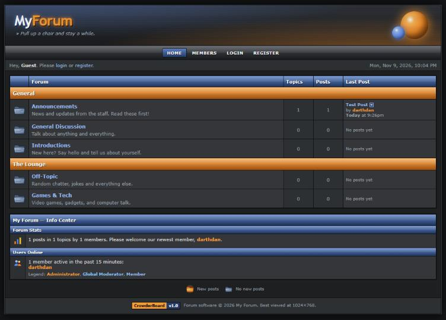

# CrowderBoard

**A classic, early-2000s style message board — dark panels, glossy blue and orange bars, folder icons and all — that runs as a static website on top of a free [Supabase](https://supabase.com) project.**

No PHP, no server to maintain: upload a folder of HTML/CSS/JS anywhere that hosts static files, point it at your Supabase project, and you have a forum.

## Features

- **Board index** with categories, topic/post counts, "last post" info, and an Info Center (stats, who's online, newest member)
- **Topics & replies** with paging, sticky/locked/hot topic folders, view counts, and new-post indicators
- **BBCode editor** — bold, italic, links, images, quotes (nested), code, lists, colors, sizes — plus a smilies bar
- **Member profiles** — avatar, signature, location, post count, rank titles and stars
- **Search** — full-text search across posts and topic titles with phrase/exclude syntax, filters for board, author and titles-only, highlighted snippets, and jump-to-post links; quick search box on every page
- **Members list** with search by username, filter by position, and sorting
- **Private messages** with inbox, sent items and reply-with-quote
- **Mobile & installable** — responsive phone/tablet layout and a PWA manifest + service worker, so members can "Install app" to their home screen
- **Spam protection** — new members can't post links/images until they have a few posts (default 3), optional approval queue for their first posts, optional Cloudflare Turnstile human check at sign-up
- **Moderation** — sticky, lock, move and delete topics; edit/delete any post; members can **Report** a post, staff work a **Reports** queue and an **Approval Queue**, every staff action lands in a **Mod Log**, and bans can carry a reason the member sees
- **Board moderators** — admins and global moderators can make any member the Moderator of a single board or a whole category; they get moderation powers there only, and are listed under each board on the index
- **Admin Center**
  - Assign board/category moderators (global moderators get a Mod CP with just this section)
  - **Spam Protection** settings: link blocking, approval queue, human check
  - Add, rename, reorder and delete categories and boards; staff-only boards (e.g. Announcements)
  - Find any member by name and change their position (Member, Global Moderator, Administrator, Banned) and custom title right from the results
  - **Look & Feel**: forum name, banner (classic text logo, image URL, uploaded JPG, or custom HTML), username colors for each position (Administrator, Global Moderator, Moderator, Member), five theme presets plus 25 color pickers, fonts, custom CSS, and site-wide header/footer HTML — all with live preview
- **Search-engine friendly (v1.4)** — crawlable twin pages for every topic and board (title, description, canonical, Open Graph, post text), a sitemap, a *Share link* on topics, and page metadata that follows the topic you're viewing. See [Search engines](#search-engines-v14)
- Original period-style icon set (folders, message icons, smilies) drawn as inline SVG — no image files to host

## Requirements

- A free Supabase project (database + login). One project can host the forum alongside other apps — every table is prefixed `forum_`.
- Any static web host: GitHub Pages, Netlify, Cloudflare Pages, Vercel, an S3 bucket, or plain shared hosting.

## Setup (about 10 minutes)

1. **Create a Supabase project** at [supabase.com](https://supabase.com) (the free tier is fine).
2. **Create the database.** In your project open **SQL Editor → New query**, paste the contents of [`sql/schema.sql`](sql/schema.sql), and click **Run**. This creates the tables, security rules and a few starter boards.
3. **Configure the forum.** In Supabase go to **Project Settings → API** and copy the **Project URL** and the **publishable / anon key**. Paste them into [`config.js`](config.js).
   > Only ever use the *publishable* (anon) key. **Never** put the `service_role` / secret key in `config.js` — it bypasses all security rules.
4. **Set login redirects.** In Supabase go to **Authentication → URL Configuration** and set **Site URL** to your forum's address (e.g. `https://example.com/forum/`). Add it under **Redirect URLs** too. This makes email confirmation and password-reset links come back to the forum.
5. **Upload the files** (`index.html`, `config.js`, `style.css`, `icons.js`, `theme.js`, `app.js`, `search.js`, `admin.js`) to your web host.
6. **Make yourself admin.** Open the forum, click **Register**, and create your account. Then run [`sql/make_admin.sql`](sql/make_admin.sql) in the SQL Editor with your username filled in. Refresh — an **Admin** link appears in the nav bar.

### Banner image size

To use a picture as the banner, go to **Admin → Look & Feel → Banner → Upload JPG**. Make it **1080 × 150 pixels** (a 7.2 : 1 strip). Larger or differently shaped images are scaled and center-cropped to exactly 1080 × 150 in the browser before upload, and then re-compressed to stay under 1.5 MB. Uploads go to a public Supabase Storage bucket called `forum-assets` that only administrators can write to.

That's it. Customize everything else from **Admin → Look & Feel** and **Admin → Boards & Members**.

### Recommended Supabase settings

- **Authentication → Providers → Email:** keep *Confirm email* on to slow down spam sign-ups.
- **Authentication → Password security:** turn on *leaked password protection*.
- **Authentication → SMTP:** the built-in email sender is limited to a few messages per hour. For a real community, plug in your own SMTP provider so confirmation and reset emails always go out.

## How it works

| File | Purpose |
|---|---|
| `index.html` | Page shell; loads the scripts below |
| `config.js` | Your Supabase URL and publishable key |
| `style.css` | Base layout and the classic look |
| `icons.js` | The SVG icon set |
| `theme.js` | Loads site settings; renders the banner, theme colors, custom CSS/HTML; HTML sanitizer |
| `app.js` | The forum: routing, boards, topics, posting, profiles, PMs, login |
| `search.js` | Forum search and the searchable Members list |
| `admin.js` | Admin Center (boards, member roles, Look & Feel) |
| `mod.js` | Reports, Approval Queue, Mod Log, Spam Protection settings, report dialog, Turnstile human check |
| `mobile.css` | Phone and tablet layout |
| `pwa.js`, `sw.js`, `manifest.json`, `icons/` | Installable-app support (edit the names in `manifest.json` for your forum) |
| `tools/prerender.mjs` | Writes crawlable `t/<id>.html`, `b/<id>.html` and `sitemap.xml` for static hosts (v1.4) |
| `supabase/functions/forum-seo/` | Optional read-only edge function that serves the same pages live, plus `sitemap.xml` and `robots.txt` (v1.4) |
| `supabase/functions/forum-join/` | Optional edge function that checks the Turnstile token when someone creates their profile |
| `sql/schema.sql` | Database tables, triggers, functions and row-level security |

The browser talks directly to Supabase. **All permissions are enforced inside the database** with Postgres row-level security, column-level grants and a few `SECURITY DEFINER` functions — hiding a button in the UI is never what keeps someone out. See [SECURITY.md](SECURITY.md) for the model and its known limits.

## Customizing

- **Rank titles and star thresholds:** `rank()` in `app.js`
- **Topics/posts per page and the "hot topic" threshold:** constants at the top of `app.js`
- **Theme presets:** `THEME_PRESETS` in `theme.js`
- **Icons:** `icons.js` — each icon is a small SVG you can edit

## Upgrading

When a release adds database changes, run the matching file in [`sql/migrations/`](sql/migrations) once in the SQL Editor, then upload the new files. Run them in order, skipping any you've already applied:

- `sql/migrations/v1.1_search.sql` — forum and member search (for forums installed with v1.0)
- `sql/migrations/v1.2_board_mods_banner.sql` — board/category moderators and banner JPG uploads (for forums installed before v1.2)

- `sql/migrations/v1.3_spam_moderation.sql` — reports, approval queue, link blocking, mod log, ban reasons (for forums installed before v1.3)

- v1.4 (search engines) needs no database change.

Username colors need no database change.

### Search engines (v1.4)

Crawlers ignore everything after the `#` in a URL, so `#/thread/12` pages can't be indexed. v1.4 gives each public topic and board a crawlable twin page that shows the title, description, canonical URL, Open Graph tags and post text. People who open a twin page are sent straight on to the real forum (`#/thread/12`); crawlers and link-preview bots stay on the twin. Only content a logged-out visitor can read is used — the pages are built with your *publishable* key, so Postgres row-level security decides what appears. No database changes are needed.

**Option A — static pages (works on any static host).**

1. Run `node tools/prerender.mjs --base https://your-site/forum/` (Node 18+; reads `config.js`). It writes `t/<id>.html`, `b/<id>.html` and `sitemap.xml`. Use `--out <dir>` to write somewhere else, or `--input data.json` to build from an exported snapshot instead of fetching.
2. Upload `t/`, `b/` and `sitemap.xml` next to `index.html`.
3. In `config.js` add `shareMode: 'static'`. Topics now show a **Share link** (click to copy) and the app sets `<link rel="canonical">`, the page title/description and Open Graph tags to match the twin page while a topic or board is open.
4. Submit `https://your-site/forum/sitemap.xml` in Google Search Console and Bing Webmaster Tools. (A `robots.txt` only counts at the root of a domain, so on a sub-folder install the sitemap has to be submitted by hand.)

Re-run the script whenever you want search engines to see new posts (a cron job or CI step works well). A topic's static page carries its first 60 posts.

**Option B — live edge function (`supabase/functions/forum-seo`).** Serves `/thread/<id>`, `/board/<id>`, `/sitemap.xml` and `/robots.txt` on demand, so new posts are visible immediately. Deploy with `supabase functions deploy forum-seo --no-verify-jwt`, set the secret `supabase secrets set FORUM_APP_URL=https://your-site/forum/` (or edit `DEFAULT_APP_URL` in the file), and add `shareMode: 'edge'` to `config.js`.

> **Important:** on the default `*.supabase.co` address, Supabase rewrites `text/html` responses to `text/plain`, so the HTML pages only render properly on a **custom domain** (a paid Supabase add-on) or when the function is proxied through your own domain/CDN. The sitemap and robots endpoints are unaffected. If you don't have one, use Option A.

Neither option can offer path-style routing for the app itself (`/thread/12` instead of `#/thread/12`) on a plain static host, because that needs the server to return `index.html` for unknown paths. The twin-page URLs (`t/12.html`) are the static-host equivalent.

### Optional: human check at sign-up (Cloudflare Turnstile)

Link blocking, the approval queue and reports work with no extra setup. To also require a human check:

1. Create a free Turnstile widget at dash.cloudflare.com for your forum's domain.
2. Deploy `supabase/functions/forum-join` (`supabase functions deploy forum-join`) and set the secret: `supabase secrets set TURNSTILE_SECRET_KEY=...`
3. In **Admin → Spam Protection**, paste the site key, click *Check human-check setup*, tick *Require it* and Save.

If your Supabase project is shared with other apps, prefer this over Supabase's project-wide CAPTCHA setting, which would apply to every app's sign-ups.

## Contributing

Issues and pull requests are welcome. If you change the database, update `sql/schema.sql` and describe the change so existing forums can apply it.

## License

[MIT](LICENSE) © 2026 Dan Crowder

*Built with the help of an AI assistant (Claude by Anthropic). Not affiliated with any other forum software.*
