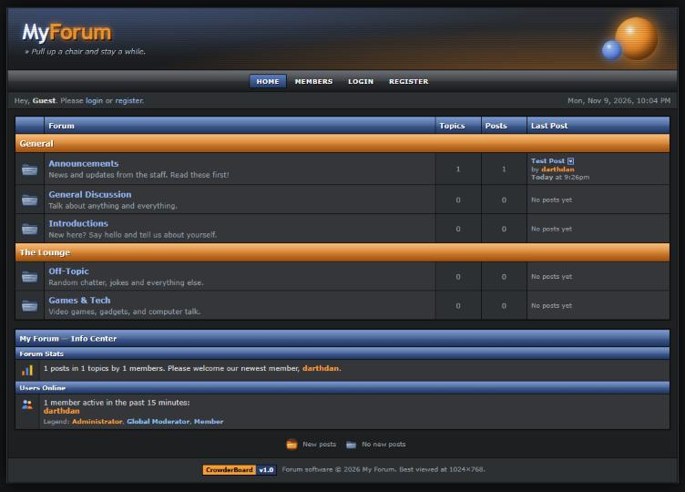

# CrowderBoard

**A classic, early-2000s style message board — dark panels, glossy blue and orange bars, folder icons and all — that runs as a static website on top of a free [Supabase](https://supabase.com) project.**

No PHP, no server to maintain: upload a folder of HTML/CSS/JS anywhere that hosts static files, point it at your Supabase project, and you have a forum.

## Features

- **Board index** with categories, topic/post counts, "last post" info, and an Info Center (stats, who's online, newest member)
- **Topics & replies** with paging, sticky/locked/hot topic folders, view counts, and new-post indicators
- **BBCode editor** — bold, italic, links, images, quotes (nested), code, lists, colors, sizes — plus a smilies bar
- **Member profiles** — avatar, signature, location, post count, rank titles and stars
- **Private messages** with inbox, sent items and reply-with-quote
- **Moderation** — sticky, lock, move and delete topics; edit/delete any post
- **Admin Center**
  - Add, rename, reorder and delete categories and boards; staff-only boards (e.g. Announcements)
  - Promote members to Moderator/Administrator, give custom titles, ban users
  - **Look & Feel**: forum name, banner (classic text logo, image, or custom HTML), five theme presets plus 25 color pickers, fonts, custom CSS, and site-wide header/footer HTML — all with live preview
- Original period-style icon set (folders, message icons, smilies) drawn as inline SVG — no image files to host

## Requirements

- A free Supabase project (database + login). One project can host the forum alongside other apps — every table is prefixed `forum_`.
- Any static web host: GitHub Pages, Netlify, Cloudflare Pages, Vercel, an S3 bucket, or plain shared hosting.

## Setup (about 10 minutes)

1. **Create a Supabase project** at [supabase.com](https://supabase.com) (the free tier is fine).
2. **Create the database.** In your project open **SQL Editor → New query**, paste the contents of [`sql/schema.sql`](sql/schema.sql), and click **Run**. This creates the tables, security rules and a few starter boards.
3. **Configure the forum.** In Supabase go to **Project Settings → API** and copy the **Project URL** and the **publishable / anon key**. Paste them into [`config.js`](config.js).
   > Only ever use the *publishable* (anon) key. **Never** put the `service_role` / secret key in `config.js` — it bypasses all security rules.
4. **Set login redirects.** In Supabase go to **Authentication → URL Configuration** and set **Site URL** to your forum's address (e.g. `https://example.com/forum/`). Add it under **Redirect URLs** too. This makes email confirmation and password-reset links come back to the forum.
5. **Upload the files** (`index.html`, `config.js`, `style.css`, `icons.js`, `theme.js`, `app.js`, `admin.js`) to your web host.
6. **Make yourself admin.** Open the forum, click **Register**, and create your account. Then run [`sql/make_admin.sql`](sql/make_admin.sql) in the SQL Editor with your username filled in. Refresh — an **Admin** link appears in the nav bar.

That's it. Customize everything else from **Admin → Look & Feel** and **Admin → Boards & Members**.

### Recommended Supabase settings

- **Authentication → Providers → Email:** keep *Confirm email* on to slow down spam sign-ups.
- **Authentication → Password security:** turn on *leaked password protection*.
- **Authentication → SMTP:** the built-in email sender is limited to a few messages per hour. For a real community, plug in your own SMTP provider so confirmation and reset emails always go out.

## How it works

| File | Purpose |
|---|---|
| `index.html` | Page shell; loads the scripts below |
| `config.js` | Your Supabase URL and publishable key |
| `style.css` | Base layout and the classic look |
| `icons.js` | The SVG icon set |
| `theme.js` | Loads site settings; renders the banner, theme colors, custom CSS/HTML; HTML sanitizer |
| `app.js` | The forum: routing, boards, topics, posting, profiles, PMs, login |
| `admin.js` | Admin Center (boards, roles, Look & Feel) |
| `sql/schema.sql` | Database tables, triggers, functions and row-level security |

The browser talks directly to Supabase. **All permissions are enforced inside the database** with Postgres row-level security, column-level grants and a few `SECURITY DEFINER` functions — hiding a button in the UI is never what keeps someone out. See [SECURITY.md](SECURITY.md) for the model and its known limits.

## Customizing

- **Rank titles and star thresholds:** `rank()` in `app.js`
- **Topics/posts per page and the "hot topic" threshold:** constants at the top of `app.js`
- **Theme presets:** `THEME_PRESETS` in `theme.js`
- **Icons:** `icons.js` — each icon is a small SVG you can edit

## Contributing

Issues and pull requests are welcome. If you change the database, update `sql/schema.sql` and describe the change so existing forums can apply it.

## License

[MIT](LICENSE) © 2026 Dan Crowder

*Built with the help of an AI assistant (Claude by Anthropic). Not affiliated with any other forum software.*
